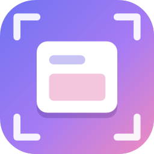
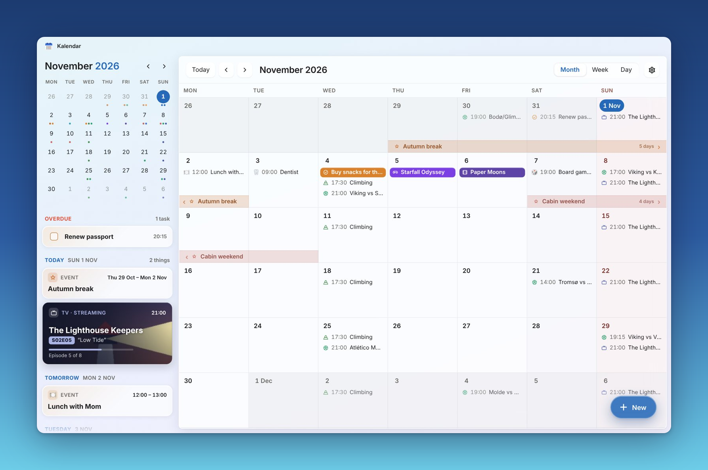
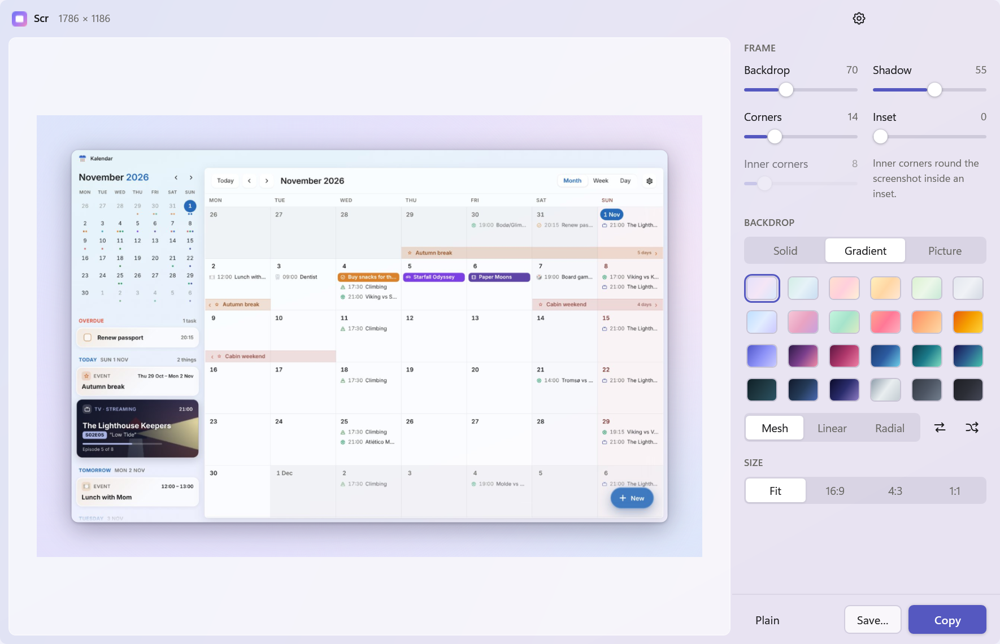
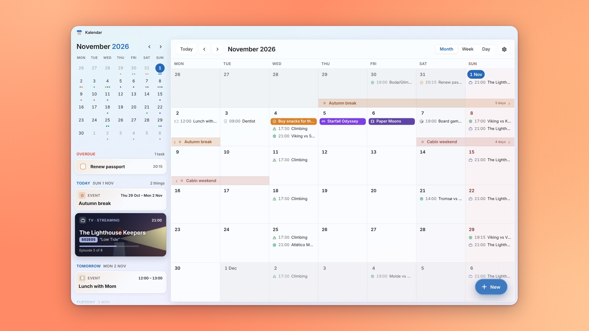
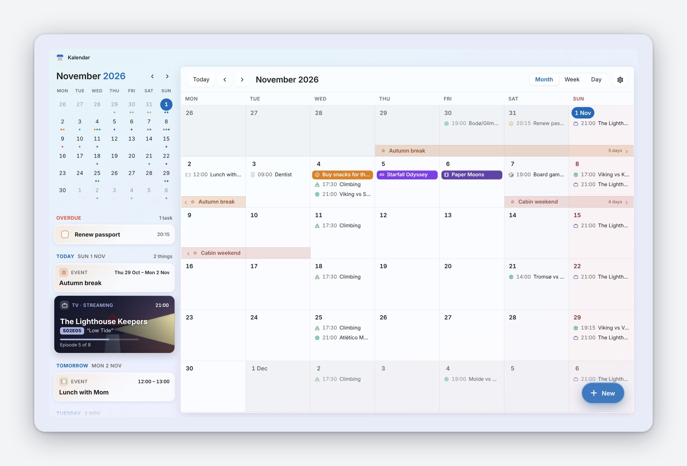
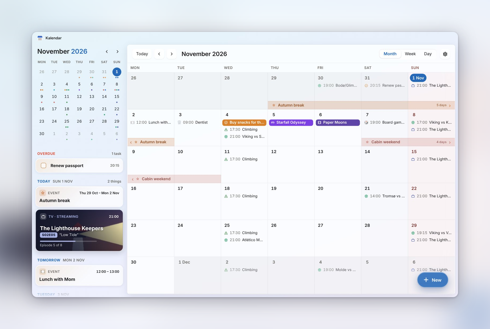
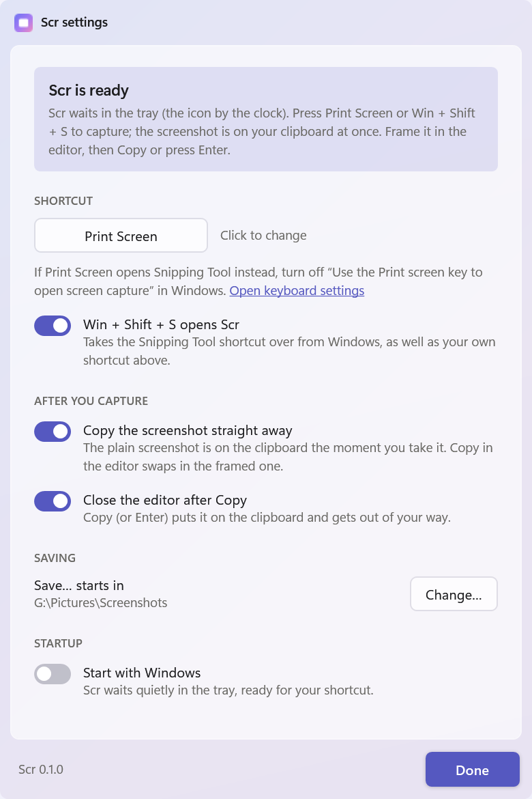

<p align="center">
  
</p>

<h1 align="center">Scr</h1>

<p align="center">
  A small, fast screenshot app for Windows that makes your captures look good.<br>
  Named after the <kbd>Prt Scr</kbd> key.
</p>

<p align="center">
  <a href="https://github.com/ecnot/scr/releases/latest"><b>Download the latest version</b></a>
</p>

<p align="center">
  
</p>

Press <kbd>Print Screen</kbd> or <kbd>Win</kbd> + <kbd>Shift</kbd> + <kbd>S</kbd>, pick an area or a window, and the
screenshot is on your clipboard straight away, just like Snipping Tool. If you want it to look nice, frame it in the
editor: rounded corners, a soft shadow, some room around it and a backdrop. Then press Copy (or Enter) to put the framed one
on the clipboard instead.

Scr is meant to replace Snipping Tool for everyday use. It waits in the tray using only a few MB of memory, and taking a
capture is instant.

## The editor

<picture>
  <source media="(prefers-color-scheme: dark)" srcset="docs/screenshots/editor-dark.png">
  
</picture>

- **Frame:** Backdrop (the room around it), Shadow, Corners, Inset (a margin in the screenshot's own edge colour) and Inner corners.
- **Backdrop:** a solid colour (or see-through), one of 24 gradients drawn as Mesh, Linear or Radial (with Swap and Shuffle), or a picture: a blurred copy of the screenshot itself, or one of your own.
- **Size:** Fit, 16:9, 4:3 or 1:1, for posts and slides.
- **Plain** takes the frame off, and clicking it again puts the frame back. Scr remembers your last frame for next time.
- **Copy** (<kbd>Enter</kbd> or <kbd>Ctrl</kbd> + <kbd>C</kbd>) and **Save…** (<kbd>Ctrl</kbd> + <kbd>S</kbd>, PNG).

The window follows Windows' light or dark mode and has the frosted Windows 11 look.

<p align="center">
  
  
</p>
<p align="center">
  
</p>

## Capturing

When you press the shortcut, the screen freezes and dims. Then:

- **drag** to pick an area,
- **click** a window to take just that window,
- press <kbd>Enter</kbd> to take the whole screen,
- or press <kbd>Esc</kbd> or right-click to cancel.

It works across several monitors, each with its own scaling, and captures in real pixels.

Click the tray icon to capture too. Right-click it to capture the whole screen, open your screenshots folder,
change Settings or quit. Starting Scr again while it's running also takes a capture, so a pinned Scr icon works as a
capture button.

## Settings

<picture>
  <source media="(prefers-color-scheme: dark)" srcset="docs/screenshots/settings-dark.png">
  
</picture>

- **Shortcut:** <kbd>Print Screen</kbd> to start with. Click it and press the keys you'd like instead.
- **Win + Shift + S opens Scr:** takes the Snipping Tool shortcut over from Windows (on to start with).
- **Copy the screenshot straight away** and **Close the editor after Copy.**
- Where **Save…** starts (Pictures\Screenshots to start with), and **Start with Windows**.

### Print Screen and Snipping Tool

Windows 11 gives the Print Screen key to Snipping Tool. To use it for Scr, turn off
**Settings → Accessibility → Keyboard → "Use the Print screen key to open screen capture"**.
Scr's Settings has a link straight there.

Windows keeps <kbd>Win</kbd> + <kbd>Shift</kbd> + <kbd>S</kbd> for itself, so Scr catches it with a low-level keyboard
hook that sees those keys before Windows does. The hook ignores every other key, and it only runs while there's
something to catch. One limit: while an app running as administrator is in front, Windows doesn't pass keys to Scr,
so Snipping Tool may open instead.

## Install

1. Scr needs the free **.NET 10 Desktop Runtime**. If you don't have it:
   ```
   winget install Microsoft.DotNet.DesktopRuntime.10
   ```
2. Download **Scr-x.y.z.zip** from [the latest release](https://github.com/ecnot/scr/releases/latest), unzip it
   anywhere you like (for example `C:\Apps\Scr`), and run **Scr.exe**.

The first time, Scr opens Settings with a short welcome. After that it waits in the tray, by the clock.
Turn on Start with Windows to have it there every day.

- `Scr.exe --tray` starts it quietly in the tray (this is what Start with Windows uses).
- `Scr.exe --quit` closes a running Scr, for example before you update it.

### Private

Scr doesn't go online at all. Your screenshots stay on your PC and on your clipboard. Its settings are in
`%APPDATA%\Scr\settings.json`, and Start with Windows is a value named "Scr" under
`HKCU\Software\Microsoft\Windows\CurrentVersion\Run`.

## Build it yourself

You need the free .NET 10 SDK:

```
winget install Microsoft.DotNet.SDK.10
```

Then run **`build.bat`**. It builds into `dist\` (about half a megabyte) and closes a running Scr first.

Scr is written in C# with WPF on .NET 10, with no extra packages. The tray icon and the shortcuts use Win32 directly.

| File | What it does |
|---|---|
| `src/App.xaml.cs` | Startup, one Scr at a time, tray actions, giving memory back after a capture |
| `src/CaptureSession.cs`, `src/OverlayWindow.cs` | The frozen, dimmed screen: one overlay per monitor, in real pixels |
| `src/ScreenCapture.cs` | The screen copy, monitors and window outlines |
| `src/FrameRenderer.cs`, `src/Pixels.cs` | The frame: backdrop, shadow, corners, inset. The same drawing is shown live and rendered for Copy and Save |
| `src/EditorWindow.xaml(.cs)` | The editor |
| `src/SettingsWindow.xaml(.cs)` | Settings and the shortcut recorder |
| `src/TrayIcon.cs`, `src/Hotkey.cs` | Tray icon, menu and global shortcut |
| `src/KeyboardHook.cs` | Takes over Win + Shift + S, or a shortcut another app already has |
| `src/Theme.xaml`, `src/ThemeColors.cs`, `src/GlassWindow.cs` | The look: colours, frosted window, light and dark |
| `tools/make-icon.ps1` | Draws `src/Assets/scr.ico` |

A Debug build has `Scr.exe --preview <folder> <picture>`, which draws the editor, Settings and some framed examples
to PNG files without opening any windows. That's how the pictures on this page were made.

Scr is a sibling of [Kalendar](https://github.com/ecnot/kalendar), and it borrows Kalendar's Lavender colours.
